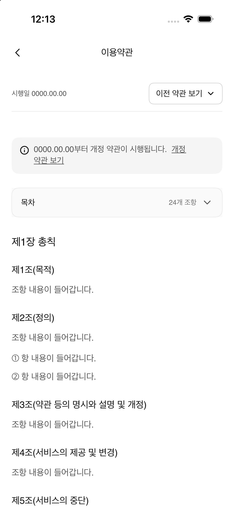

# A-36u 이용약관 개정 예정 고지 패리티

- Figma node: `656:7989` (390 × 1383 pt)
- Figma screen: [A-36u 이용약관 · 개정 예정 고지](https://www.figma.com/design/N3Ic9TfSnUBVMgAuayBVly?node-id=656-7989)
- Implementation: `TermsView.Version.revisionScheduled`, shared `TermsDocument`
- Entry: Settings → 이용약관

## Figma 내용

- 기존 약관 시행일 및 이전 약관 버전 선택 버튼
- 인라인 안내 카드: `0000.00.00부터 개정 약관이 시행됩니다. 개정 약관 보기`
- 본문 24개 조항, 5개 장, 목차 카드
- 화면 크기 390 × 1383 pt
- `개정 약관 보기` 문구는 시각적으로 밑줄 처리되어 있으나 Figma 프로토타입 연결은 없음

## 구현 범위

- 기존 약관 화면의 레이아웃·토큰·에셋·문서 데이터를 재사용
- 개정 예정 안내 문구와 밑줄 문구를 Figma 카피에 맞춤
- Settings의 이용약관 진입 경로에서 개정 예정 안내 변형을 표시
- 버전 버튼은 후속 #90에서 구현할 버전 선택 화면으로 연결 예정
- 안내 문구에는 Figma 반응이 없으므로 별도 화면 이동을 만들지 않음

## 시각 검증

Figma 디자인 컨텍스트의 화면 렌더와 390 pt 프레임을 기준으로 검증. 시뮬레이터 비교 캡처와 확인 결과는 PR에 첨부한다. 시스템 상태바 및 홈 인디케이터는 iOS가 렌더링한다.

확인 결과 상단 약관 정보, 개정 예정 안내 카드, 목차, 장·조항의 순서와 문구가 Figma와 맞는다. 캡처 기기는 402 pt 폭이라 Figma 390 pt 프레임보다 12 pt 넓고, 캡처는 기기 상태바와 현재 스크롤 위치를 포함한다. 이 비교는 화면 구조와 주요 시각 요소를 대상으로 하며 픽셀 단위 일치를 주장하지 않는다.
