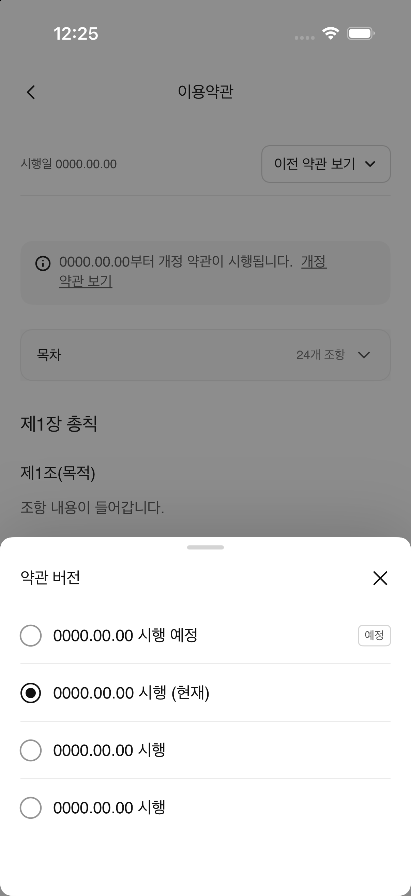

# A-36v 약관 버전 선택 패리티

- Figma node: `657:7797` (390 × 844 pt)
- Figma screen: [A-36v 약관 버전 선택](https://www.figma.com/design/N3Ic9TfSnUBVMgAuayBVly?node-id=657-7797)
- Implementation: `TermsVersionPickerView`, `TermsVersionOption`
- Entry: 이용약관 화면의 버전 선택 버튼

## 화면 구성

- dim 48% 배경과 상단 모서리 12 pt의 바텀시트
- grabber, `약관 버전` 제목, 닫기 아이콘
- 56 pt 높이의 버전 행 4개와 24 pt 하단 여백
- 예정 행의 `예정` badge, 현재 행의 선택 radio
- 기존 `ProductOptionClose`, `ReturnRadioSelected` 에셋과 공통 색상·타이포그래피 재사용

## 확인된 Figma 동작

- 현재 및 이전 약관 화면의 버전 버튼이 선택 시트를 연다.
- 세 번째 버전 행(`657:7890`)만 이전 약관 화면 (`656:7778` wrapper → `656:7779`)으로 이동한다.
- 예정, 현재, 마지막 버전 행에는 이동 반응이 없다. 구현도 별도 목적지를 만들지 않는다.
- 닫기 아이콘과 배경 dim 탭은 시트를 닫는 기본 UI 동작으로 제공한다.
- 이전 화면으로 이동하면 Settings에서 돌아오는 기존 back 동선을 유지한다.

## 시각 검증

Figma의 390 × 844 pt 프레임과 iPhone 17 Pro 402 × 874 pt 캡처를 비교했다. 두 화면의 sheet 높이와 구성, 행 간격, 선택 상태를 확인했다. 실제 화면의 하단 안전 영역과 현재 약관에 추가된 개정 예정 안내 때문에 주변 콘텐츠 위치가 다르며, 픽셀 단위 일치는 주장하지 않는다.
