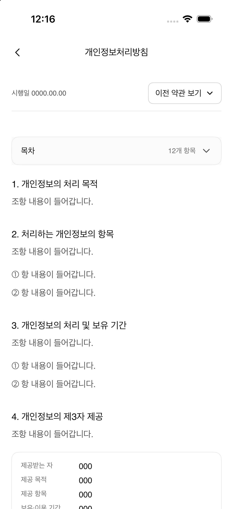

# A-37 개인정보처리방침 패리티

- Figma node: `656:8199` (390 × 2045 pt)
- Figma screen: [A-37 개인정보처리방침](https://www.figma.com/design/N3Ic9TfSnUBVMgAuayBVly?node-id=656-8199)
- Implementation: `PrivacyPolicyView`, `PrivacyPolicyDocument`
- Entry: Settings → 개인정보처리방침

## 화면 구성

- 공통 상단 바, 시행일, 버전 선택 모양, 12개 항목 목차
- 개인정보 처리 목적부터 처리방침 변경까지 12개 섹션
- Figma 문구 `조항 내용이 들어갑니다.`와 `항 내용이 들어갑니다.` 사용
- 제2·3항의 예시 항목과 제4·5·10항의 정보 카드 구현
- 제4·5항 카드는 흰 바탕과 테두리, 제10항 책임자 카드는 subtle 바탕
- 기존 뒤로 가기, 약관 버전 화살표, 목차 화살표 에셋과 디자인 토큰 재사용

## 상호작용 및 제한

- 개인정보처리방침 화면은 Settings의 정책 행에서 진입하고 뒤로 가면 Settings로 돌아간다.
- Figma에서 이 화면과 버전 선택 모양의 prototype reaction을 확인하지 못해 해당 요소는 디자인 표현으로만 표시한다.
- 내용은 Figma에 표시된 placeholder를 유지하며 실제 사업자·처리 목적·보유 기간 값은 추정하지 않는다.

## 시각 검증

Figma 렌더와 비교해 상단 정보, 목차, 제목·본문 순서, 3개 정보 카드의 위치와 스타일을 확인했다. 캡처 기기의 폭은 402 pt로 Figma 390 pt 프레임보다 12 pt 넓으며 시스템 상태바와 스크롤 위치가 포함된다. 비교 결과는 주요 시각 구조 기준이며 픽셀 단위 일치를 의미하지 않는다.
