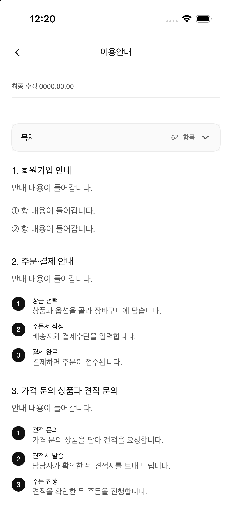
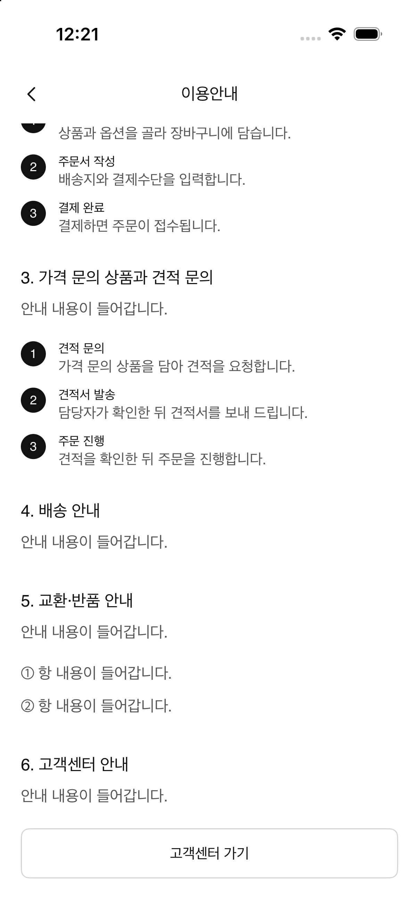

# A-38 이용안내 패리티

- Figma node: `656:8465` (390 × 1397 pt)
- Figma screen: [A-38 이용안내](https://www.figma.com/design/N3Ic9TfSnUBVMgAuayBVly?node-id=656-8465)
- Implementation: `UsageGuideView`, `UsageGuideDocument`
- Entry: Settings → 이용안내

## 화면 구성

- 최종 수정일 메타데이터, 6개 항목 목차
- 가입, 주문·결제, 견적 문의, 배송, 교환·반품, 고객센터 안내
- 주문·결제와 견적 문의 흐름은 각 3단계 번호 행으로 표시
- 가입 및 교환·반품 항목은 Figma 예시 항목 표시
- 마지막 고객센터 버튼은 공통 `EUMButton` 보조 스타일 사용
- 기존 뒤로 가기 및 목차 화살표 에셋과 토큰 재사용

## 이동 관계와 콘텐츠 한계

Figma의 `고객센터 가기` 버튼(`656:8680`)은 고객센터 화면 `661:8065`로 연결된다. 실제 고객센터 화면은 #96 범위이므로 현재 버튼은 후속 이슈 연결 안내를 표시한다. 화면 본문은 Figma의 `안내 내용이 들어갑니다.` placeholder를 그대로 사용하며 실제 운영 안내로 추정하지 않는다.

## 시각 검증

상단과 하단을 각각 캡처해 실제 iPhone viewport에서 스크롤되는 화면 전체를 확인했다.

Figma 렌더와 비교해 날짜, 목차, 6개 항목의 문구·순서, 단계 번호와 CTA를 확인했다. 캡처 기기는 402 pt 폭으로 Figma 390 pt 프레임보다 12 pt 넓으며 각 이미지에 기기 상태바와 현재 스크롤 위치가 포함된다. 캡처는 화면 구조와 주요 시각 요소를 검토한 결과이며 픽셀 단위 일치를 뜻하지 않는다.
