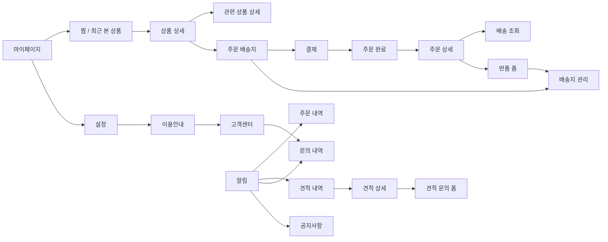

# 화면 이동 흐름과 연결 상태

확인일: 2026-10-20. Figma 기준 페이지: `06 Design — App` (`178:345`).
`SCREEN_INVENTORY.md`의 88개 프레임에는 별도 화면 외에 오류·빈 상태·시트·변형이 포함된다. 완전한 프로토타입 전이 그래프는 확보되지 않았다.

## 경로와 복귀 정책

`HomeNavigationState`가 선택 탭과 `HomeNavigationPath`를 함께 관리한다. `HomeNavigationPath`에는 일반 화면, 상품 목록, 목록에서 연 검색, 상품 상세, 주문·결제 단계를 쌓는다. 각 항목에 안정적인 ID를 부여해 하위 화면을 표시하는 동안 기존 화면의 폼·필터·스크롤·읽음 상태를 유지한다. 비활성 화면은 터치와 접근성 탐색 대상에서 제외한다.

- 뒤로가기: 실제 진입 화면으로 한 단계 복귀한다. 배송 조회에서 무조건 주문 상세로 이동하거나, 찜 상품 상세에서 마이페이지로 빠지는 예외 분기를 제거했다.
- 탭 이동: 중첩 이력을 정리하고 선택한 탭으로 이동한다.
- 검색 탭의 뒤로가기: 검색 탭을 열기 전 선택 탭으로 돌아간다. 목록에서 검색한 경우는 탭 전환이 아니라 목록 위에 검색을 쌓으므로 검색의 뒤로가기는 목록으로 돌아간다.
- 홈/카테고리 상품 목록: 목록은 진입한 탭 위에 쌓는다. 홈의 카테고리·추천·베스트셀러에서 열면 홈으로, 카테고리 탭의 분류·전체 제품에서 열면 카테고리로 복귀한다. 목록의 탭 바도 원래 탭을 선택 상태로 표시한다.
- 홈/카테고리 상단 검색: 현재 화면 위에 검색을 쌓고, 검색의 뒤로가기는 해당 홈/카테고리 화면으로 돌아간다.
- 상품 목록 안의 검색: 검색을 화면 스택에 쌓아 목록 화면과 정렬·스크롤 상태를 보존한다. 검색 결과 상품 상세까지 열면 뒤로가기는 상품 목록 → 목록 진입 화면 순으로 복귀한다. 다른 탭을 누르면 해당 탭으로 전환하고 중첩 화면을 정리한다.
- 홈/쇼핑 계속하기: 상품·결제·계정 하위 이력을 정리하고 홈으로 이동한다.
- 드로어 → 회사소개: 닫으면 드로어로 돌아간다. 홈 배너 → 회사소개는 홈으로 돌아간다.
- 약관 버전: 같은 화면 안에서 현재/이전 문서를 선택하며, 화면을 중복해서 쌓지 않는다. Figma의 개정 예정 고지는 현재 약관 위에 표시한다.
- 로그인 내부: 비밀번호 찾기를 연 화면(로그인/이메일 찾기/이메일 결과)으로 복귀한다.

그림의 전방 이동에는 뒤로가기 이력이 쌓인다. 홈/탭 전환은 위의 이력 초기화 정책을 따른다. 문의 작성 등 디자인이 없는 목적지는 그림에서 구현된 것처럼 표시하지 않았다.

## 연결된 기존 화면

| 진입점 | 연결 결과 | 데이터 및 복귀 범위 |
|---|---|---|
| Splash | Home | 기존 UIKit 진입 구조 사용 |
| Home 검색창 제출 / Category 상단 검색 | 검색 / 결과 / 결과 없음 | 현재 탭 화면 위에 검색을 쌓아 뒤로가면 같은 홈/카테고리 화면으로 복귀 |
| 하단 검색 탭 | 검색 / 결과 / 결과 없음 | 탭 전환으로 검색 탭 진입. 뒤로가기는 직전 탭으로 복귀 |
| 상품목록 검색 | 검색 / 결과 / 결과 없음 | 상품목록 위에 검색을 쌓아 검색어·결과 상태를 유지하고 뒤로가면 같은 목록으로 복귀 |
| Home 배너 | 회사소개 A-43 | 홈/드로어 진입 위치 구분 |
| Home 카테고리·추천·베스트셀러 | 상품목록 A-04 | Home 탭을 유지하며 뒤로가기는 홈으로 복귀. 목록에서 검색/상품 상세를 열어도 스택 순서대로 복귀 |
| Category 분류·전체 제품 | 상품목록 A-04 또는 견적 문의 A-15 | Category 탭을 유지하며 뒤로가기는 카테고리로 복귀. 현재 목업은 상품 분류 속성이 없어 카테고리별 결과 정확성은 미구현 |
| Category 브랜드 탭 | 브랜드 목록 A-33 → 브랜드 상세 A-34 → 상품 상세 | 상품에서 돌아와 기존 브랜드 선택 유지 |
| Home·검색·상품목록·찜·최근 본 상품·장바구니·브랜드 상품 | 상품 상세 A-05/A-05h | 실제 진입 화면 복귀. 관련 상품을 연 경우 이전 상품으로 복귀 |
| 상품 상세 | 옵션 시트 / 장바구니 탭 / 견적 문의 / 주문 배송지 | 바로 구매의 폼 이동 연결. 실제 장바구니 추가/주문 생성 성공을 뜻하지 않음 |
| 상품 상세의 배송·교환 `자세히 보기` | 배송·교환 안내 | 뒤로 가면 기존 상품 상세 화면과 스크롤 위치로 복귀. 표시 정책은 샘플 문구이며 실제 상품별 정책은 미연동 |
| 장바구니 | 상품 상세 / 견적 문의 / 주문 배송지 | 목업 상품 사용 |
| 주문 배송지 → 결제 → 완료 → 주문 상세 | A-08 → A-09(결제/증빙 변형) → A-10/A-10v → A-17 | 완료의 결제수단별 기존 샘플 상세. 상세 뒤로가기 → 원래 완료 |
| 주문 배송지/반품 폼 → 배송지 관리 → 추가/수정 | A-24/A-24e | 편집 저장/닫기 → 관리; 관리 닫기 → 기존 폼. 폼 상태 보존; 실제 배송지 반영은 별도 데이터 흐름 |
| 마이페이지·비로그인 마이페이지 | 설정/로그인/내 정보/상품 및 계정 내역/고객센터/공지 | 지원 화면은 공통 경로 사용 |
| 마이페이지 주문 현황 | 선택 상태의 주문 내역 A-16 | 입금대기/결제완료/배송준비/배송중/배송완료 필터 |
| 알림 A-32 | 배송 → 배송중 주문; 주문 → 전체 주문; 견적 → 견적 내역; 문의 → 문의 내역; 공지 → 공지 목록 | 알림에 대상 ID가 없어 임의 상세를 선택하지 않음. 복귀 시 읽음 상태 유지 |
| 주문 내역/상세 | 주문 상세/배송 조회/반품 폼/취소·반품·교환 내역 | 배송 조회는 실제 진입 목록/상세로 복귀. 취소·교환 폼과 신청 상세는 신규 디자인 필요 |
| 견적 내역의 카드/견적서 보기 | 선택한 견적 상세 A-25d | PDF 다운로드는 별도 파일 연동 |
| 견적 상세의 재견적 요청 | 기존 견적 문의 폼 A-15 | 새 목업 폼. 기존 상품·수량/원문을 복사한 결과가 아님. 닫기 → 원래 견적 상세 |
| 견적 문의 완료 | 문의 내역 또는 홈(쇼핑 계속하기) | 목업 접수 결과. 실제 서버 접수 아님 |
| 고객센터/FAQ/공지 목록 | FAQ 결과·없음 / 문의 내역·상세 / 공지 상세 | 전화번호/파일 다운로드는 실제 정보 필요 |
| 설정/약관 | 약관 현재·이전·개정 예정 고지/버전 시트, 개인정보처리방침, 이용안내, 로그아웃/탈퇴 진입 | 네 번째 과거 약관·개정 원문은 제공된 데이터가 없어 안내. 본문은 Figma 자리표시자 그대로 |
| 내 정보 인증/수정 | 비밀번호·휴대폰 변경, 탈퇴 안내/불가/사유/확인/완료 | 조건에 따른 기존 화면. 현재 주문 목업에 미완료 주문이 있어 일반 실행의 탈퇴 진입은 불가 화면 |
| 로그인/가입 | 개인·사업자 가입, 약관/개인정보 동의서, 이메일 찾기 결과·없음, 비밀번호 재설정·완료 | 필수 동의서 연결됨. 마케팅 동의 `보기`는 승인 문구가 없는 안내 화면으로 연결하며 동의를 기록하지 않음. 인증 성공은 서버 미연동 |

## 디자인 및 데이터가 필요한 목적지

[추가 화면·데이터 요청 및 경로 구현 상태](MISSING_SCREEN_DESIGN_REQUESTS.md)에 D-01~D-12 각각의 연결 여부와 남은 UI·데이터·정책 요구사항을 기록했다. 현재 각 항목의 진입 목적지는 구현되어 있으며, 샘플 UI 연결을 실제 서비스 연동 완료로 간주하지 않는다.

- 추가 UI 결정: 취소/교환 접수 결과와 신청 상세의 운영 상태, 리뷰/이벤트 빈 상태 및 상세 상호작용, 상품별 정책 상세 디자인. 현재 화면 진입 경로는 연결되어 있다.
- 서비스/데이터: 실제 인증·결제·주문/반품 접수·재주문, 주소/리뷰/이벤트 데이터, 문서 다운로드, 연락처/주소, 승인 약관·마케팅 동의 원문과 시행일, 알림 대상 ID.
- 약관 본문: Figma A-36 `656:7470`를 재조회해 본문 `조항 내용이 들어갑니다`/시행일 `0000.00.00`를 확인했다. 사용자 지시에 따라 이 Figma 문구를 그대로 사용한다. 실제 약관 작성·원문 교체는 이번 작업 범위가 아니다.

## 이번 검증

2026-10-17 수정에서 상품목록과 목록 내 검색을 `HomeNavigationPath`의 화면 항목으로 관리한다. 새 회귀 테스트는 홈/카테고리 각각의 목록 복귀, 목록 → 검색 → 목록, 검색에서 연 상품 상세 → 기존 목록 복귀를 확인한다. 다른 탭 이동은 기존 정책대로 스택 전체를 비운다.

- 2026-10-17 `swiftlint lint --strict --quiet`: 통과.
- 2026-10-17 iPhone 18 Pro / iOS 27.0 Simulator `xcodebuild test`: 152개 통과, 실패 0개. XCResult 결과는 `Passed`.
- `ProductListNavigationUITests`: iPhone 18 Pro / iOS 27.0 Simulator에서 실제 버튼을 누르는 UI 자동화 7개 통과. 홈/카테고리 상품 목록 복귀, 홈·카테고리 검색 복귀, 목록 검색 후 목록 복귀, 상품 상세 → 목록 → 홈 복귀, 검색 탭의 이전 탭 복귀, 목록에서 장바구니 탭 전환을 확인했다.
- 상품 목록/검색/상세의 뒤로가기와 중첩 탭바에는 접근성 식별자를 부여해 UI 자동화가 같은 한국어 레이블을 가진 다른 버튼을 잘못 선택하지 않도록 했다.
- 기존 152개 단위 테스트도 같은 Simulator에서 재실행해 통과했다. UI 자동화 7개와 단위 테스트 152개는 별도 실행으로 검증했다.
- GitHub Actions의 Tuist 검증 단계에서 단위 테스트와 UI 테스트를 함께 실행하도록 구성했다.
- UI 자동화는 문서화된 주요 상품 탐색 경로를 검증한다. SCREEN_INVENTORY의 88개 Figma 프레임 각각을 자동 탭한 것은 아니며, 디자인 없는 화면/실제 인증·결제·주문 연동/실기기 동작은 검증 범위가 아니다.
- 최신 앱 빌드를 Simulator에 설치하고 실행했다. Device Hub 접근성 트리에서 홈, 개인보호장비 진입 버튼, 탭 바가 표시됨을 확인했다. 앱 화면/프로세스 확인이며 버튼 탭 E2E 검증은 아니다.

- `tuist generate --no-open`: 성공.
- `swiftlint lint --strict --quiet`: 위반 없음.
- `xcodebuild ... -destination 'platform=iOS Simulator,id=2AA5B084-D480-4D16-B95D-3A524ACBEF88' -derivedDataPath /tmp/eum-route-build CODE_SIGNING_ALLOWED=NO build`: 성공.
- 동일 Simulator에서 전체 `test`: **144 tests, 0 failures**. 초기 #197 경로 테스트 3개 집중 실행도 통과. 최종 약관 선택 규칙 정리 후 `TermsVersionOptionTests` 3개를 다시 실행해 통과했다.
- 실행 환경: iPhone 18 Pro / iOS 27.0. 실제 탭/뒤로가기와 접근성 트리로 다음을 확인했다.
  - 마이 → 찜 → 상품 → 뒤로가기 → 원래 찜 → 마이.
  - 설정 → 이용안내 → 고객센터 → 문의 내역 → 고객센터 → 이용안내.
  - 알림 → 배송중 주문 → 알림; 읽지 않음 2개에서 1개로 변경된 상태 유지.
  - 알림 → 견적 내역 → 견적서 보기 → 견적 상세 → 재견적 폼 → 원래 견적 상세.
  - 마이페이지 배송중 주문 버튼 → 배송중 필터 → 배송 조회 → 같은 필터의 주문 내역.
  - 약관 버전 시트 → 이전 약관 표현.
- 캡처: [원래 찜 목록 복귀](../Screenshots/route-favorites-return.png), [배송 알림의 주문 목록](../Screenshots/route-notification-orders.png).
- 전체 88개 프레임을 전수 실행한 증거가 아니며 Figma 픽셀 일치, 실제 인증/결제/접수, 실기기 검증을 주장하지 않는다. 신규 화면의 로딩/오류/빈 상태는 디자인 요청 범위다.

## 2026-10-20 경로 점검

- D-01~D-12 목적지의 현재 라우트/뷰 구현을 코드와 대조하고, 디자인·목업 요구와 실제 서비스 데이터 미연동 상태를 문서에서 구분했다.
- 가입 마케팅 동의 `보기`에서 안내를 열고 가입 폼으로 돌아오는 개인/사업자 UI 테스트를 추가했다. 로컬 iPhone 17 Pro / iOS 26.5 Simulator 전체 테스트 180개 통과, PR #234 CI 전체 테스트 180개 통과.
- 이 검증은 시뮬레이터/목업 경로 기준이다. 실제 인증·결제·주문 접수 및 실기기 서비스 동작을 증명하지 않는다.
